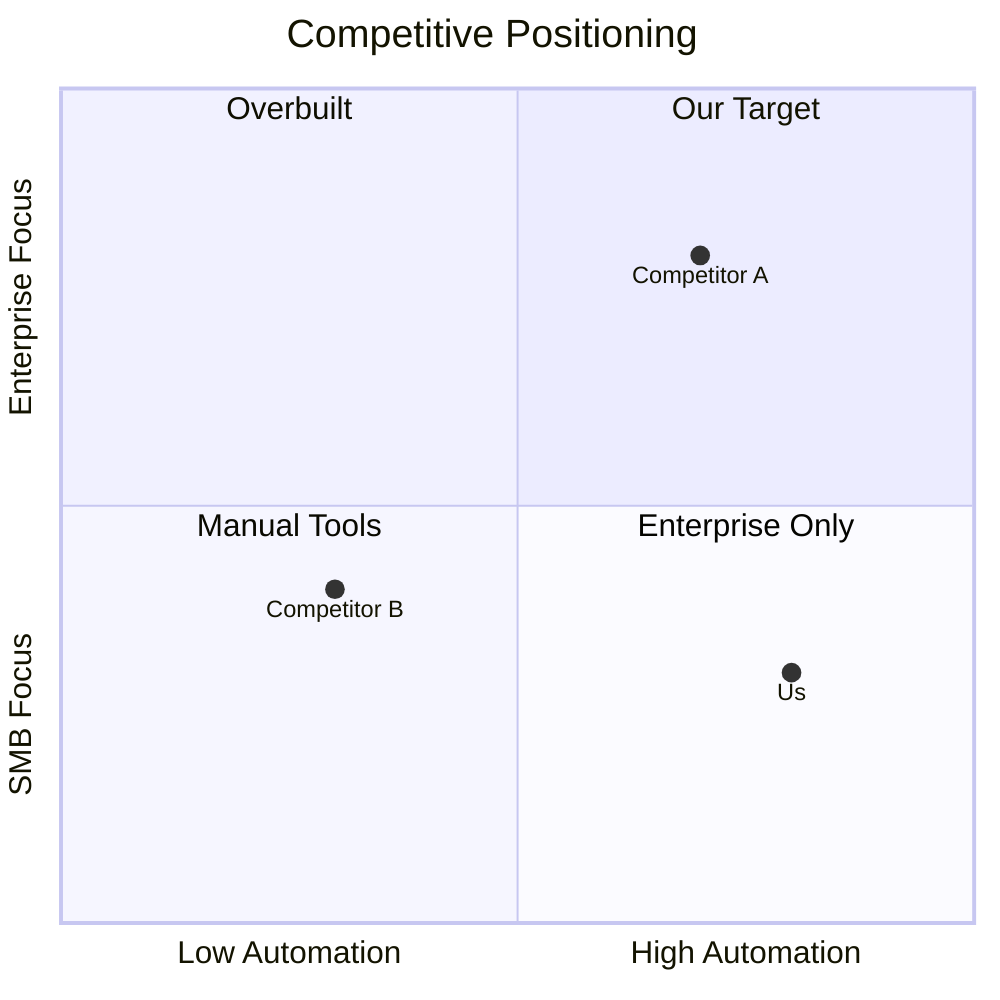

# Unishell — Product Vision - 17 February, 2026

> Claude Code for Product Teams — with a UI instead of a terminal.

---

## What Unishell Actually Is

Unishell is a desktop app that wraps Claude Code (via ACP) with a purpose-built UI for product work. It eliminates the need to juggle Notion, Google Docs, Figma, Canva, Miro, and a terminal by providing a single workspace where Claude Code does the heavy lifting and the UI handles rendering, editing, and organizing the outputs.

**The key insight**: Claude Code already knows how to write PRDs, generate wireframes as HTML, create pitch decks, do market research, draw Mermaid diagrams, and build mind maps. The problem is that accessing all of this through a terminal sucks for product work. Unishell is the UI layer that makes Claude Code's product capabilities accessible.

**What it replaces:**

| Tool | Unishell Equivalent |
|------|-------------------|
| Notion / Google Docs | Markdown editor with rich rendering |
| Figma (rough wireframes) | HTML wireframes rendered inline |
| Canva (decks) | Markdown-driven slide presentations |
| Miro (mind maps) | Mermaid + HTML mind maps in docs |
| Terminal Claude Code | Visual side panel with project context |
| Manual CLAUDE.md setup | Auto-managed project context |

---

## Core Concept: Project = Folder

When you create a project, Unishell asks you to **select or create a directory** on your Mac. That's it. The project IS the folder. Everything is plain files. If Unishell dies tomorrow, your work survives.

```
~/projects/my-saas-idea/
├── .unishell/
│   ├── CLAUDE.md              ← Auto-managed, always up to date
│   ├── project.json           ← Metadata, phase, settings
│   └── workflow-state.json    ← Active workflow progress
├── research/
│   ├── market-landscape.md
│   ├── competitors.md
│   └── tam-sam-som.md
├── docs/
│   ├── prd.md
│   ├── user-personas.md
│   └── user-journeys.md
├── wireframes/
│   ├── landing-page.html
│   ├── dashboard.html
│   └── onboarding-flow.html
├── decks/
│   ├── pitch-deck.md          ← Markdown slides with --- separators
│   └── investor-update.md
└── notes/
    ├── brainstorm-jan15.md
    └── meeting-notes.md
```

### The `.unishell/CLAUDE.md` — Auto-Managed Context

This is what makes Unishell fundamentally different from using Claude in a browser. Instead of you manually writing CLAUDE.md every time you start a Claude Code session, **Unishell maintains it automatically**.

```markdown
# Project: My SaaS Idea

## Overview
A B2B tool for solo accountants to automate client reporting.

## Current Phase: Research

## Key Decisions Made
- Target market: SMB accounting firms (decided 2025-01-15)
- Pricing model: Usage-based (decided 2025-01-18)
- V1 scope: Single-user only, no team features (decided 2025-01-20)

## Active Documents
- /research/competitors.md — Competitive analysis (complete)
- /docs/prd.md — Product Requirements (in progress)
- /wireframes/dashboard.html — Main dashboard wireframe (draft)

## Open Questions
- What's the right onboarding flow?
- Should we support CSV export in v1?

## Assumptions
- TAM: $2.3B (see /research/tam-sam-som.md)
- Target user: Solo accountants with 10-50 clients
- Willingness to pay: $29-49/mo based on competitor pricing
```

**How it stays updated:**
- When Claude creates/edits files → file list updates automatically
- When you make decisions in conversation → Claude logs them to decisions section
- When workflows complete → outputs are registered
- Phase changes trigger a full context refresh
- You can also manually edit it — it's just a markdown file

---

## App Layout

### Home Screen

Minimal. Two things matter:

- **Recent Projects** — Cards showing project name, phase, last edited timestamp
- **New Project** — One click → pick/create a folder → you're in the workspace

No dashboards, no analytics, no widgets. You're a solo user. Get in, get to work.

### Workspace — The Core UI

Three-panel layout. This is where you live 99% of the time.

```
┌─────────────────────────────────────────────────────────────────┐
│ ◀ ▶  My SaaS Idea              [Phase: Research ▾]       [⚙]  │
├──────────┬─────────────────────────────┬────────────────────────┤
│          │                             │                        │
│ Explorer │      Editor / Viewer        │   Claude Panel         │
│          │                             │                        │
│ ▼ research                             │  ┌────────┬──────────┐ │
│   market..│                            │  │ Chat   │ Workflow │ │
│   compet..│  ┌───────────────────────┐ │  ├────────┴──────────┤ │
│ ▼ docs    │  │                       │ │  │                   │ │
│   prd.md  │  │  [Active document     │ │  │  Claude Code      │ │
│   persona │  │   rendered based      │ │  │  conversation     │ │
│ ▼ wirefr..│  │   on file type:       │ │  │  with full        │ │
│   landing.│  │                       │ │  │  project context  │ │
│   dashbo..│  │   .md → rich editor   │ │  │                   │ │
│ ▼ decks   │  │   .html → live prev.  │ │  │  Can read/write   │ │
│   pitch.. │  │   deck.md → slides    │ │  │  any project file │ │
│ ▼ notes   │  │   mermaid → diagrams  │ │  │                   │ │
│           │  │                       │ │  │                   │ │
│           │  └───────────────────────┘ │  └───────────────────┘ │
│           │  [Edit] [Preview] [Split]  │  [message input     ▾] │
├──────────┴─────────────────────────────┴────────────────────────┤
│ ● Claude connected │ research/competitors.md │ 1,247 words      │
└─────────────────────────────────────────────────────────────────┘
```

---

## Panel Deep Dives

### Explorer (Left Panel — Collapsible)

Shows the **actual filesystem** of the project folder. Not a virtual tree — real files.

**Behaviors:**
- Drag to reorder/reorganize files and folders
- Right-click context menu: "Ask Claude about this file", "Rename", "Delete", "Duplicate"
- New file button with type picker: Document (.md), Wireframe (.html), Deck (.md in /decks), Note (.md)
- File icons indicate type: 📄 doc, 🖼 wireframe, 📊 deck, 🔬 research, 📝 note
- Folders are user-created — no enforced structure, but project template provides sensible defaults

**New Project Template:**
When you create a new project, the folder gets scaffolded with:
```
/research/
/docs/
/wireframes/
/decks/
/notes/
.unishell/
```
You can rename, delete, or add folders freely. It's your filesystem.

### Editor/Viewer (Center Panel — Primary Focus)

This is the multi-format engine that replaces 5 apps. The editor **detects file type and renders accordingly**.

#### Mode 1: Rich Markdown Editor (for .md files)

**Rendering**: Inline preview like Typora — you type markdown, it renders in place. Not split-pane.

**Supported blocks:**
- Standard markdown: headers, bold, italic, links, images, code blocks, blockquotes
- Tables: rendered with sortable columns, horizontal scroll for wide tables
- Mermaid diagrams: fenced `mermaid` blocks render as interactive diagrams inline
- Embedded HTML blocks: fenced `html` blocks render in sandboxed iframes inline
- Task lists with checkboxes
- Callout blocks (custom syntax):
  ```
  > [!insight] Key Finding
  > 73% of solo accountants still use Excel for client reporting.

  > [!decision] Target Market
  > Focusing on firms with 10-50 clients. Rationale: largest underserved segment.

  > [!assumption] Pricing
  > Users will pay $29-49/mo based on competitor analysis.

  > [!question] Open
  > Should we support team accounts in v1?

  > [!risk] Technical
  > Real-time sync could be complex for v1 scope.
  ```
- Footnotes and source references

**Why callout blocks matter:** Claude uses these automatically when generating research docs and PRDs. They create a structured vocabulary for product decisions that persists across the project. When Claude sees `[!assumption]` blocks, it knows these are things to validate. When it sees `[!decision]` blocks, it logs them to CLAUDE.md.

#### Mode 2: Wireframe Viewer (for .html files in /wireframes/)

**Rendering**: Live HTML preview in a sandboxed iframe.

**How it works:**
- Claude generates full HTML files with inline CSS and basic JS
- The viewer renders them at realistic viewport sizes (desktop/tablet/mobile toggle)
- Edit toggle switches to raw HTML source
- Annotation mode: click elements → floating toolbar → "Ask Claude to change this"

**What these wireframes look like:**
Not Figma. Not pixel-perfect. Think: **functional HTML mockups** — styled divs, real typography, clickable navigation, form elements. Good enough to validate layout and flow. Claude is actually quite good at generating these.

**Example prompt to Claude in the panel:**
"Create a wireframe for the main dashboard. It should show a client list on the left, selected client's reports in the center, and a quick-actions sidebar on the right."

Claude generates `/wireframes/dashboard.html` → it appears in the explorer → click to preview.

#### Mode 3: Slide Deck Viewer (for .md files in /decks/)

**Rendering**: Presentation view with slide navigation.

**Format**: Markdown with `---` as slide separators (similar to Marp/Slidev):

```markdown
---
theme: clean
---

# My SaaS Idea
## Pitch Deck — January 2025

---

# The Problem

73% of solo accountants still use Excel for client reporting.
This costs them **8 hours/week** on average.

> [!insight] Source
> Based on survey of 200 accountants (see /research/market-landscape.md)

---

# The Solution

**AutoReport** — Automated client reporting for solo accountants.

- Connects to existing accounting software
- Generates branded reports automatically
- One-click delivery to clients

---

# Market Size

| Segment | Size |
|---------|------|
| TAM | $2.3B |
| SAM | $450M |
| SOM | $12M (Year 1) |

---

# Competitive Landscape


```

**Viewer features:**
- Slide-by-slide navigation (arrow keys, click)
- Fullscreen presentation mode
- Mermaid diagrams render on slides
- Tables render properly
- Edit mode switches to raw markdown
- Theme support (a few built-in clean themes)
- Export to PDF (via print)

**Why markdown decks?** Because Claude can generate and edit them. Try asking Claude to "add a slide about competitive moats after the market size slide" — it just inserts markdown. No XML, no proprietary format, no drag-and-drop hell.

#### Mode 4: Mermaid Diagram Viewer

When a standalone `.mermaid` file is opened, or when mermaid blocks appear in markdown, they render as interactive diagrams.

**Supported diagram types Claude commonly generates:**
- Flowcharts (user journeys, decision trees)
- Mindmaps (brainstorming, feature mapping)
- Quadrant charts (competitive positioning)
- Sequence diagrams (system flows)
- Gantt charts (rough timelines)
- Entity relationship diagrams (data models)

### Annotation System (Across All File Types)

This is the **bridge between the editor and Claude**. It's how you have a conversation *about* the document rather than *around* it.

**How it works:**

1. Select text in any document (or click an element in a wireframe)
2. Floating toolbar appears with quick actions:
   - 💬 **Discuss** — Opens a thread in Claude Panel about this text
   - ✏️ **Refine** — Claude rewrites the selection, shows inline diff
   - 🔍 **Challenge** — Claude plays devil's advocate on this claim/decision
   - 📝 **Expand** — Claude adds more detail, evidence, or context
   - 🔗 **Source** — Claude finds supporting evidence via web search
   - ❌ **Delete** — Claude suggests what to replace this with (or removes it)
3. The annotation links to a thread in the Claude Panel with the selected text as context
4. Resolved annotations disappear. Unresolved ones show as subtle margin markers.

**Why this matters:** This is the workflow you currently can't do. In Claude Code terminal, you'd have to copy text, paste it into the prompt, explain what you want, then copy the output back. With annotations, it's: select → click → done.

### Claude Panel (Right Panel — Persistent, Resizable)

This is your ACP-connected Claude Code interface. Two tabs.

#### Tab 1: Chat

Freeform conversation with full project awareness.

**What Claude always knows:**
- Which file is currently open in the editor
- Full contents of `.unishell/CLAUDE.md` (all project context)
- The project's file tree structure
- Current phase
- All previous conversations in this project session

**What Claude can do:**
- Create new files anywhere in the project (they appear in explorer immediately)
- Edit existing files (changes show in editor in real-time)
- Search the web for market data, competitor info, etc.
- Generate mermaid diagrams, HTML wireframes, markdown decks
- Read and reference any file in the project

**Example interactions:**

```
You: "Create a PRD for the reporting feature based on what we know from the research"
Claude: [reads /research/competitors.md, /research/market-landscape.md,
         /research/tam-sam-som.md]
        → Creates /docs/prd-reporting.md with full PRD
        → Updates CLAUDE.md with new document reference

You: "The wireframe for the dashboard needs a notification bell in the top right"
Claude: [reads current /wireframes/dashboard.html]
        → Edits the HTML file
        → Change appears in the viewer immediately

You: "Add a slide about our go-to-market strategy to the pitch deck"
Claude: [reads /decks/pitch-deck.md]
        → Inserts new slide markdown after the appropriate section
        → Slide appears in the deck viewer
```

#### Tab 2: Workflows

Structured, multi-step Claude Code sessions that produce specific outputs. These are the opinionated pipelines that save you from staring at a blank page.

**How workflows work:**
1. Select a workflow from the menu (or Claude suggests one based on your phase)
2. Each workflow has 3-5 steps
3. Each step asks you structured questions → produces a concrete output file
4. Steps build on each other — output from step 1 feeds into step 2
5. You can pause, resume, skip steps, or restart
6. Workflow state persists in `.unishell/workflow-state.json`

---

## Workflows — Complete Spec

### Workflow 1: Idea Generation & Validation

**When to use:** Start of a new project, or when pivoting direction.
**Outputs:** Problem canvas, idea angles, validation matrix, decision doc.

**Step 1 — Problem Space Exploration**
- Claude asks structured questions:
  - What domain / industry are you interested in?
  - What frustrations have you noticed (yours or others')?
  - Who specifically feels this pain?
  - What do they do today to solve it?
- Claude synthesizes into a problem statement canvas
- **Output:** `/research/problem-canvas.md`
- Format: Structured doc with sections for Problem, Who Feels It, Current Alternatives, Why Now, Why You

**Step 2 — Idea Expansion**
- Claude generates 5-7 product angles from the problem space
- Each angle includes:
  - One-liner description
  - Target user profile
  - Core mechanic (what it actually does)
  - Why it might work (tailwinds)
  - Why it might fail (headwinds)
  - Rough complexity estimate (weekend project → 6-month build)
- **Output:** `/research/idea-angles.md`
- User can annotate individual angles: "explore this more", "kill this", "combine with #3"

**Step 3 — Quick Validation Checklist**
- For selected angles (user picks 2-3 favorites), Claude evaluates:
  - Can you build an MVP in 4 weeks?
  - Is there an existing community/audience to sell to?
  - What's the simplest monetization path?
  - What's the "hair on fire" signal — do people urgently need this?
  - Are there clear distribution channels?
  - What's the competitive moat?
- **Output:** `/research/validation-matrix.md` (comparison table of selected angles)

**Step 4 — Decision Document**
- Claude synthesizes everything into a 1-page decision doc:
  - Chosen direction with rationale
  - Key assumptions that need to be true
  - What "success in 90 days" looks like
  - Immediate next steps
- **Output:** `/research/decision.md`
- Claude updates CLAUDE.md with the chosen direction

### Workflow 2: Market Research & Competitive Analysis

**When to use:** After choosing a direction. Understand the landscape before building.
**Outputs:** Market landscape, competitor deep dive, gap analysis, opportunity brief.

**Step 1 — Market Landscape**
- Claude uses web search to map the market:
  - Market size and growth trajectory
  - Key players (direct and indirect competitors)
  - Recent trends and shifts
  - Funding activity in the space
  - Regulatory considerations
- **Output:** `/research/market-landscape.md`
- Sources auto-referenced with links

**Step 2 — Competitor Deep Dive**
- Claude identifies 5-8 direct and indirect competitors
- For each:
  - What they do (1-2 sentence summary)
  - Target audience
  - Pricing model and tiers
  - Key strengths
  - Key weaknesses (from reviews, social media, etc.)
  - Recent moves (launches, pivots, funding)
- **Output:** `/research/competitors.md` with comparison table
- Includes Mermaid quadrant chart for competitive positioning

**Step 3 — Gap Analysis**
- Claude cross-references competitors with your problem canvas
- Identifies:
  - Underserved user segments
  - Feature gaps no competitor addresses
  - Pricing opportunities (too expensive, no free tier, etc.)
  - Positioning angles (speed, simplicity, specific niche)
  - Distribution advantages you might have
- **Output:** `/research/gap-analysis.md`

**Step 4 — Opportunity Brief**
- 1-page synthesis:
  - Here's the market (size, growth, trends)
  - Here's the gap (what's missing)
  - Here's why you can win (your angle)
  - Here's the risk (what could go wrong)
- **Output:** `/research/opportunity-brief.md`
- This is the doc you'd share with a co-founder or advisor

### Workflow 3: TAM/SAM/SOM Sizing

**When to use:** After market research, before committing to build.
**Outputs:** Assumptions log, top-down model, bottom-up model, sizing summary.

**Step 1 — Assumption Gathering**
- Claude asks structured questions:
  - Geographic scope (global, US-only, India, etc.)
  - Buyer profile (role, company size, industry, budget authority)
  - Price point range (from competitor analysis or your gut)
  - Purchase frequency (monthly SaaS, annual, per-transaction)
  - Conversion funnel assumptions (awareness → trial → paid)
- **Output:** `/research/sizing-assumptions.md`
- Every assumption is tagged with confidence level (high/medium/low)

**Step 2 — Top-Down Sizing**
- Claude builds TAM from industry reports and public data:
  - Total industry spend in the category
  - Narrow to your geographic scope
  - Narrow to your buyer segment
  - Apply your price point
- Shows math explicitly — not just numbers
- **Output:** `/research/tam-top-down.md`

**Step 3 — Bottom-Up Sizing**
- Claude builds from unit economics up:
  - Total number of target buyers (from census data, industry reports, LinkedIn, etc.)
  - Realistic penetration rate by year
  - Revenue per user (from your pricing assumptions)
  - Growth rate assumptions
  - 3-year projection
- **Output:** `/research/tam-bottom-up.md`

**Step 4 — Sizing Summary**
- Side-by-side comparison: top-down vs bottom-up
- Sensitivity analysis: What if price is 2x? What if market is 50% smaller?
- Final TAM/SAM/SOM with confidence ranges
- Mermaid funnel diagram showing the narrowing
- **Output:** `/research/tam-sam-som.md`

### Workflow 4: PRD & Spec Writing

**When to use:** When you're ready to define what you're building.
**Outputs:** User personas, user stories, PRD, technical considerations.

**Step 1 — User Personas**
- Claude generates 2-3 personas from research:
  - Demographics, role, goals, frustrations
  - Current workflow (what they do today)
  - What "success" looks like for them
  - Quote that captures their mindset
- **Output:** `/docs/user-personas.md`

**Step 2 — User Stories & Journeys**
- For each persona, Claude maps:
  - Key user stories (As a ___, I want to ___, so that ___)
  - Happy path journey (step-by-step from discovery to daily use)
  - Pain points in the current journey
  - Mermaid flowchart of the core user journey
- **Output:** `/docs/user-journeys.md`

**Step 3 — PRD**
- Claude writes a full PRD pulling from all existing project context:
  - Problem statement (from problem canvas)
  - Target users (from personas)
  - Solution overview
  - Feature list with priority (P0/P1/P2)
  - Success metrics
  - Scope & non-goals
  - Open questions
- **Output:** `/docs/prd.md`

**Step 4 — Technical Considerations**
- Claude writes technical notes for the engineering handoff:
  - Architecture suggestions
  - Key technical decisions to make
  - Integration requirements
  - Data model sketch
  - Rough effort estimates
- **Output:** `/docs/technical-notes.md`

### Workflow 5: Pitch Deck Creation

**When to use:** When you need to present the idea — to investors, co-founders, advisors, or yourself.
**Outputs:** Complete markdown slide deck.

**Step 1 — Deck Outline**
- Claude proposes a 10-12 slide structure:
  - Cover, Problem, Solution, Market, Product, Business Model, Traction, Competition, Team, Ask
- You approve, reorder, add/remove slides
- **Output:** `/decks/pitch-deck-outline.md`

**Step 2 — Content Generation**
- For each slide, Claude generates content pulling from existing research:
  - Problem slide ← problem canvas
  - Market slide ← TAM/SAM/SOM
  - Competition slide ← competitor analysis (with quadrant chart)
  - Product slide ← PRD + wireframes (if they exist)
- **Output:** `/decks/pitch-deck.md` (full deck in slide markdown format)

**Step 3 — Refinement**
- Interactive refinement:
  - "Make the problem slide more emotional"
  - "Add data to the market slide"
  - "The competition slide needs a clearer differentiation message"
- Each edit updates the deck file → visible in slide viewer immediately

### Workflow 6: Wireframe Generation

**When to use:** When you need to visualize key screens.
**Outputs:** HTML wireframe files.

**Step 1 — Screen Inventory**
- Claude suggests key screens based on the PRD:
  - Landing page
  - Onboarding flow
  - Main dashboard
  - Key feature screens
- You approve the list
- **Output:** List saved in workflow state

**Step 2 — Individual Screen Generation**
- For each screen, Claude generates an HTML wireframe:
  - Semantic HTML with clean CSS
  - Realistic placeholder content
  - Responsive (desktop-first, but works on smaller viewports)
  - Interactive elements (clickable nav, form inputs, hover states)
- **Output:** `/wireframes/{screen-name}.html`
- Each file is immediately viewable in the wireframe viewer

**Step 3 — Flow Connection**
- Claude links screens together:
  - Button on landing page → links to onboarding
  - Onboarding complete → links to dashboard
  - Navigation is consistent across screens
- Updates all wireframe files with navigation links

---

## Phase System

Projects naturally progress through phases. Unishell makes this explicit but flexible.

```
Ideation  →  Research  →  Sizing  →  Scoping  →  Documentation  →  Presentation
   💡          🔍          📊         🎯            📄                📊
```

**How it works:**
- Phase indicator in the top nav bar (dropdown to change manually)
- Current phase determines which workflows Claude suggests
- Phase change triggers a CLAUDE.md refresh with a transition summary
- Phases are **suggestions, not gates** — you can jump around freely
- Each phase has a soft checklist of typical outputs (not enforced)

**Phase → Workflow mapping:**

| Phase | Suggested Workflows |
|-------|-------------------|
| Ideation | Idea Generation & Validation |
| Research | Market Research, Competitive Analysis |
| Sizing | TAM/SAM/SOM |
| Scoping | PRD & Spec Writing, Wireframes |
| Documentation | PRD refinement, Technical Notes |
| Presentation | Pitch Deck Creation |

---

## Technical Architecture

### High Level

```
┌───────────────────────────────────────────────┐
│              Electron Shell                    │
│                                               │
│  ┌──────────────────────────────────────────┐ │
│  │         React Frontend                   │ │
│  │  ┌──────────┬──────────┬──────────────┐  │ │
│  │  │ Explorer │ Editor   │ Claude Panel │  │ │
│  │  │ (File    │ (TipTap/ │ (Chat +      │  │ │
│  │  │  Tree)   │  Custom) │  Workflows)  │  │ │
│  │  └──────────┴──────────┴──────────────┘  │ │
│  └──────────────────────────────────────────┘ │
│                                               │
│  ┌──────────────────────────────────────────┐ │
│  │         Electron Main Process            │ │
│  │  ┌─────────────┬────────────────────┐    │ │
│  │  │ File System │ ACP Client         │    │ │
│  │  │ Watcher     │ (Claude Code conn) │    │ │
│  │  ├─────────────┼────────────────────┤    │ │
│  │  │ CLAUDE.md   │ Workflow Engine    │    │ │
│  │  │ Manager     │ (State Machine)    │    │ │
│  │  └─────────────┴────────────────────┘    │ │
│  └──────────────────────────────────────────┘ │
└───────────────────────────────────────────────┘
              │
              ▼
      ┌───────────────┐
      │ Claude Code   │
      │ (ACP Server)  │
      │ - Web search  │
      │ - File ops    │
      │ - Tool use    │
      └───────────────┘
```

### Key Technical Decisions

**Editor: TipTap (ProseMirror-based)**
- Best plugin ecosystem for custom blocks (callouts, mermaid, HTML embeds)
- Built-in annotation/decoration support
- Markdown serialization/deserialization
- Active community, well-documented

**Project Storage: Plain filesystem**
- No database. No SQLite. Just files on disk.
- Electron's `fs` module + `chokidar` for file watching
- Changes made by Claude (via ACP file ops) trigger watcher → UI updates
- Git-friendly by default — user can version control their projects

**ACP Integration:**
- Electron main process spawns/connects to Claude Code via ACP
- Renderer communicates with main via IPC for all Claude interactions
- Every message to Claude includes the current CLAUDE.md as system context
- Claude Code's file operations target the project directory

**Workflow Engine:**
- Simple state machine in the main process
- Each workflow = JSON definition of steps, questions, output templates
- State persisted in `.unishell/workflow-state.json`
- Workflows can be paused and resumed across app restarts

**Wireframe Rendering:**
- Sandboxed `<webview>` or `<iframe>` with `sandbox` attribute
- No network access from wireframes
- Viewport controls (desktop/tablet/mobile) just resize the container

**Deck Rendering:**
- Parse markdown slides (split on `---`)
- Render each slide as a styled container
- Mermaid blocks render within slides
- Presentation mode = fullscreen slide navigation
- Could use Reveal.js or build a lightweight custom renderer

### CLAUDE.md Auto-Management

The `.unishell/CLAUDE.md` file is the bridge between the app and Claude Code. It needs to be carefully managed.

**Update triggers:**

| Event | CLAUDE.md Update |
|-------|-----------------|
| File created/deleted | Update "Active Documents" section |
| Decision made in conversation | Append to "Key Decisions" |
| Workflow step completed | Update phase + add output reference |
| Phase changed | Update "Current Phase", add transition note |
| User adds `[!assumption]` callout | Append to "Assumptions" section |
| User adds `[!question]` callout | Append to "Open Questions" section |
| Manual user edit | Preserve as-is |

**Implementation:** A watcher in the main process monitors project files and conversation events, rebuilding relevant sections of CLAUDE.md. The file is regenerated (preserving manual edits in a `## Custom Notes` section) before each Claude interaction.

---

## What to Build — Phased Roadmap

### Phase 1: Foundation (Weeks 1-3)

**Goal:** Basic Electron app with editor and file system.

- Electron shell with three-panel layout
- File tree that reads from a selected directory
- TipTap markdown editor with inline preview
- Basic file operations (create, rename, delete, save)
- Project creation (select folder → scaffold template folders)
- Syntax highlighting for code blocks

**At the end of Phase 1:** You have a basic markdown editor that works on a project folder. It's already useful for writing notes.

### Phase 2: Claude Integration (Weeks 4-6)

**Goal:** Claude Code connected via ACP with project context.

- ACP client in Electron main process
- Claude Panel with chat interface (streaming responses)
- Auto-generated CLAUDE.md from project state
- Claude can read project files (context injection)
- Claude can create/edit files (changes reflected in UI via file watcher)
- "Ask Claude about this file" context menu in explorer

**At the end of Phase 2:** You have a Cursor-like experience for product docs. Claude can read your research and write PRDs. Already 10x more useful than terminal Claude Code for product work.

### Phase 3: Multi-Format Rendering (Weeks 7-9)

**Goal:** Editor handles all file types intelligently.

- Mermaid diagram rendering in markdown
- HTML wireframe viewer with viewport controls
- Markdown slide deck viewer with presentation mode
- Callout block rendering (`[!insight]`, `[!decision]`, etc.)
- Embedded HTML blocks in markdown
- Table rendering with sort

**At the end of Phase 3:** The editor is no longer just a markdown editor — it's a multi-format product workspace.

### Phase 4: Annotations & Workflows (Weeks 10-13)

**Goal:** The features that make Unishell uniquely useful.

- Annotation system (select → floating toolbar → Claude actions)
- Inline diff view for Claude's suggested edits
- Workflow engine (state machine + step UI)
- Implement all 6 workflows
- Workflow state persistence and resume
- Phase indicator with workflow suggestions

**At the end of Phase 4:** This is the full product. You can go from idea to validated, scoped product with a pitch deck without leaving the app.

### Phase 5: Polish (Weeks 14-16)

**Goal:** Make it feel good.

- Keyboard shortcuts for everything
- Dark mode / theme support
- PDF export for decks and documents
- Cmd+K command palette (like Cursor/VS Code)
- Performance optimization for large projects
- Error handling and edge cases
- README and open-source packaging

---

## Design Principles

1. **Files are the source of truth.** Everything is markdown/HTML on disk. No proprietary format. No lock-in. If Unishell dies, your work survives in readable files.

2. **Claude is the engine, not the product.** The UI exists to make Claude Code's capabilities accessible. Don't rebuild what Claude already does — build the interface that lets it work effectively.

3. **Opinionated workflows beat flexible tools.** You don't want a blank canvas — you want someone saying "here's what to do next." The workflows provide structure. You can always go freeform in chat.

4. **Context is everything.** The entire value over using Claude in a browser is persistent, deep project context. CLAUDE.md auto-management is the most important technical feature.

5. **Start rough, refine later.** HTML wireframes won't look like Figma. Markdown decks won't look like Keynote. That's fine. The value is speed of iteration with Claude, not pixel-perfection.

6. **One project, one folder, one workspace.** No cross-project features. No sharing. No collaboration. One human + one AI + one product idea = one workspace.

---

## What to Skip (Forever, or Until It Proves Necessary)

- **User auth** — It's local. There are no users.
- **Database** — Filesystem is your database.
- **Sharing / collaboration** — Solo tool. If you need to share, export to PDF or copy the files.
- **API integrations** — No Jira, no Notion, no Slack. The whole point is one app.
- **Version control UI** — Use git from terminal if you want versioning.
- **Plugin system** — Way too early. Build the opinionated thing first.
- **Templates marketplace** — You're the only user. Hardcode the templates.
- **Analytics / tracking** — Open source. No telemetry.
